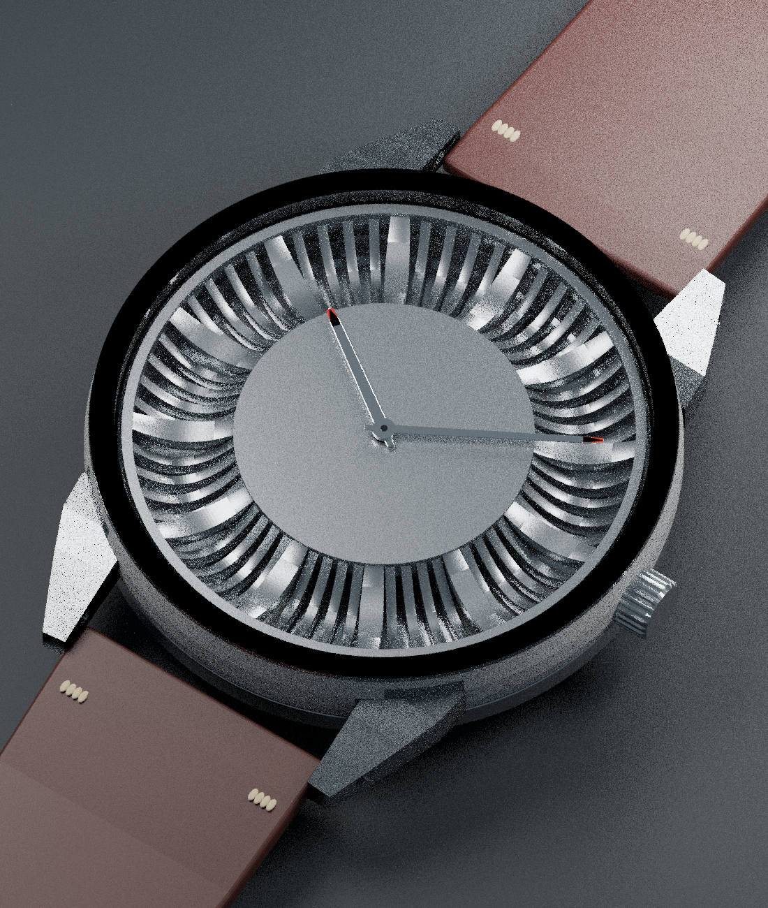

# Radial 37

An open hardware watch project aiming for an affordable, classy everyday watch: a compact 37 mm case, sculpted radial dial, slim quartz movement and domed crystal.

**Active development baseline: V3**, selected by the owner on 22 October 2026. V1 and V2 are preserved as design history. V3 is a substantial assembly study, but the archived files are **not ready for a metal-print order**.

The image illustrates the earlier V2 appearance; it is not a photograph or a validated V3 assembly. Its crystal is hidden for geometry review.

## Start here

- [Complete project analysis](docs/PROJECT_ANALYSIS.md)
- [V3 refinement plan and release gates](docs/REFINEMENT_PLAN.md)
- [Original handoff](README_FIRST.txt) — historical brief; the owner's newer V3 baseline decision takes precedence.
- Native working baseline: `project/radial37_v3/radial37_v3.blend`
- Source: `project/radial37_v3/src/radial37_v3.py` and `parameters.py`
- [Independent audit evidence](analysis/)

## Design targets

| Item | Current target / status |
|---|---|
| Case diameter | 37 mm |
| Lug-to-lug | Approximately 44 mm |
| Strap width | 18 mm |
| Dial | 60 curved radial webs, with 12 emphasized hour positions |
| Movement | Miyota 2035 confirmed by owner; archived V3 still uses a 5Y20 envelope and requires adaptation |
| Crystal | 33 mm candidate domed acrylic envelope in V3; exact purchased part unresolved |
| Metal | Stainless steel or titanium; process and supplier acceptance unresolved |
| Back | V3 models a thread; archive later requested a quarter-turn bayonet. Final choice pending owner confirmation |
| Cost / finish | Affordable, restrained and comfortable; no priced bill of materials yet |

## Status and units

V3 case and back have invalid topology. Three archived V3 STLs contain zero triangles. Filenames containing `FINISHED`, `VENDOR_REVIEW` or `PRINT_STOCK` do not indicate approval. Do not order them.

Blender geometry uses numeric millimetres and metric `scale_length=0.001`. STL has no unit metadata: import as millimetres and verify the 37 mm case diameter. Metal shell height, individual part height and complete assembled thickness are different measurements.

## Rebuilding

Blender sources use `bpy`, `bmesh` and `mathutils`; they are not normal standalone Python programs. The archive was inspected with Blender 5.2.2 LTS. Run scripts only from a working copy: they create scenes and overwrite exports beside their source. V3 also imports adjacent `parameters.py`, so add that `src` directory to Python's import path. The old cadgen/build123d sketches are historical and are not equivalent to the later Blender assembly. There is no STEP release.

Existing scripts, saved scenes, STL exports and clearance reports are not yet one synchronized, reproducible build. See the refinement plan before regenerating files.

## Open hardware and references

Original project design materials, generation scripts and project documentation are offered under [CERN-OHL-P-2.0](LICENSE), subject to the exclusions in [ATTRIBUTION.md](ATTRIBUTION.md). Copyright 2026 Sunny Gupta and contributors.

Carter Hurd's watch project is acknowledged as visual inspiration. Third-party reference screenshots and manufacturer PDFs remain in the local archive and are intentionally excluded from this public repository; source links and original checksum entries are retained. No licence to third-party work or endorsement is implied.

Contributions should keep V3's design intent, document changed dimensions, and include independently checked exports. This repository currently contains development studies rather than a qualified wearable product.

## V3 recovery checkpoint

[Review-only recovered parts and audit](development/v3_refinement/README.md) are available. The carrier, current chapter, center dial and historical back-stock model have been exported from the saved V3 scene and independently reimported. Case/back failures remain unresolved. No original geometry was changed.

Verify original local archive integrity with `python tools/verify_archive.py . --require-references`; public clones can omit `--require-references` because third-party reference assets are excluded.

[Confirmed Miyota 2035 adaptation inputs](development/v3_refinement/MIYOTA_2035_ADAPTATION.md) — selected 22 October 2026; geometry conversion pending.
