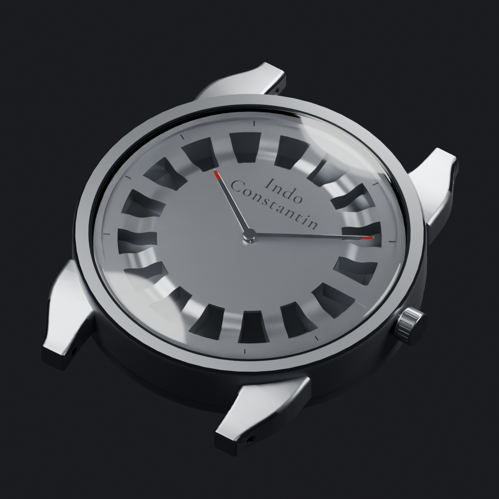

# Radial 37

An open hardware watch project aiming for an affordable, classy everyday watch: a compact 37 mm case, sculpted radial dial, slim quartz movement and domed crystal.

**Active baseline: V3. Latest candidate: [titanium bayonet 02](development/v3_titanium_bayonet_02/README.md)**, updated 22 October 2026. The archived V3 files are preserved. This new candidate has three valid titanium part targets and separate thick machining preforms; it is **QUOTE REVIEW ONLY, not released for an order**.

Owner-confirmed: Miyota 2035, quarter-turn bayonet, exactly three titanium prints and a single-piece dial, with supplier precision finishing included in the quote. The current candidate has 16 broad curved webs, a machined thin center/outer rail, rounded beveled lugs, pin holes and laser “Indo / Constantin” artwork. [Dimensions, finishing and release holds](development/v3_titanium_bayonet_02/MANUFACTURING_REVIEW.md) · [Saved-file checks](development/v3_titanium_bayonet_02/validation/RESULTS.md) · [Quote request](development/v3_titanium_bayonet_02/QUOTE_REQUEST.txt).

## Start here

- [Complete project analysis](docs/PROJECT_ANALYSIS.md)
- [V3 refinement plan and release gates](docs/REFINEMENT_PLAN.md)
- [Original handoff](README_FIRST.txt) — historical brief; the owner's newer V3 baseline decision takes precedence.
- Native working baseline: `project/radial37_v3/radial37_v3.blend`
- Source: `project/radial37_v3/src/radial37_v3.py` and `parameters.py`
- [Independent audit evidence](analysis/)

## Design targets

| Item | Current target / status |
|---|---|
| Case diameter | 37 mm |
| Lug-to-lug | Approximately 44 mm |
| Strap width | 18 mm |
| Dial | Single-piece titanium; current candidate has 16 broad curved webs and 12 laser hour indices |
| Movement | Miyota 2035 confirmed; nominal envelope checks pass in candidate 02; actual component fit pending |
| Crystal | 33 mm candidate domed acrylic envelope in V3; exact purchased part unresolved |
| Metal | TC4 titanium print preforms plus precision machining; supplier acceptance and cost pending |
| Back | Owner-confirmed 90-degree bayonet; new nominal motion checks pass; physical retention/wear pending |
| Cost / finish | Affordable, restrained and comfortable; no priced bill of materials yet |

## Status and units

Archived V3 case and back have invalid topology. Three archived V3 STLs contain zero triangles. Filenames containing `FINISHED`, `VENDOR_REVIEW` or `PRINT_STOCK` do not indicate approval. Do not order them.

Blender geometry uses numeric millimetres and metric `scale_length=0.001`. STL has no unit metadata: import as millimetres and verify the 37 mm case diameter. Metal shell height, individual part height and complete assembled thickness are different measurements.

## Rebuilding

Blender sources use `bpy`, `bmesh` and `mathutils`; they are not normal standalone Python programs. The archive was inspected with Blender 5.2.2 LTS. Run scripts only from a working copy: they create scenes and overwrite exports beside their source. V3 also imports adjacent `parameters.py`, so add that `src` directory to Python's import path. The old cadgen/build123d sketches are historical and are not equivalent to the later Blender assembly. Native STEP quote candidates now exist separately in `development/v3_titanium_bayonet_02/STEP`; there is no manufacturing release.

Existing scripts, saved scenes, STL exports and clearance reports are not yet one synchronized, reproducible build. See the refinement plan before regenerating files.

## Open hardware and references

Original project design materials, generation scripts and project documentation are offered under [CERN-OHL-P-2.0](LICENSE), subject to the exclusions in [ATTRIBUTION.md](ATTRIBUTION.md). Copyright 2026 Sunny Gupta and contributors.

Carter Hurd's watch project is acknowledged as visual inspiration. Third-party reference screenshots and manufacturer PDFs remain in the local archive and are intentionally excluded from this public repository; source links and original checksum entries are retained. No licence to third-party work or endorsement is implied.

Contributions should keep V3's design intent, document changed dimensions, and include independently checked exports. This repository currently contains development studies rather than a qualified wearable product.

## V3 recovery checkpoint

[Review-only recovered parts and audit](development/v3_refinement/README.md) are available. The carrier, current chapter, center dial and historical back-stock model have been exported from the saved V3 scene and independently reimported. Case/back failures remain unresolved. No original geometry was changed.

Verify original local archive integrity with `python tools/verify_archive.py . --require-references`; public clones can omit `--require-references` because third-party reference assets are excluded.

[Confirmed Miyota 2035 adaptation inputs](development/v3_refinement/MIYOTA_2035_ADAPTATION.md) — selected 22 October 2026; historical adaptation inputs.

**Earlier fit-study scene:** `development/v3_refinement/radial37_v3_2035_fit_01.blend`. Read the [fit-study status and checks](development/v3_refinement/FIT_STUDY_01.md) before using it. The archived V3 scene remains the preserved historical baseline.

**Latest working scene:** `development/v3_titanium_bayonet_02/radial37_titanium_bayonet_02.blend`. Consult its README before using any exports.
