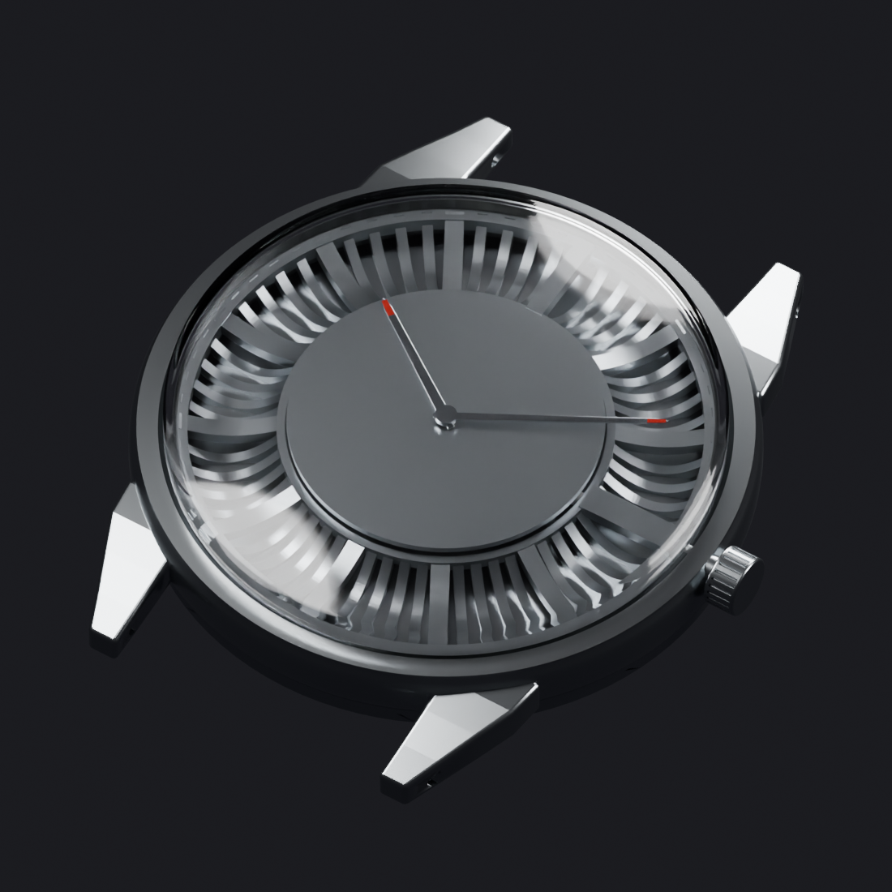

# V3 / Miyota 2035 — fit study 01

22 October 2026. Created through the restored official Blender MCP connection, Blender 5.2.2 LTS, localhost:9876. This is a **partial engineering fit study**, not a print release.

## Native scene and preservation

Open `radial37_v3_2035_fit_01.blend`; active scene is `RADIAL 37 | V3 2035 FIT STUDY 01`. The original V3 scene remains in the file, and the pre-edit live state is saved separately in `checkpoints/v3_live_before_2035.blend`. The original archived V3 file was not overwritten. Meshes in the new scene are independent copies. Materials are shared where appearance is unchanged.

## Changes made

- Added a conservative 2035 envelope, 15.3 mm along the stem axis, 18.5 mm across it, and 3.15 mm high. It is a clipped cylinder based on catalog dimensions, not exact manufacturer CAD.
- Built a carrier proposal with a new 0.20 mm nominal pocket allowance, 10.65 mm locator outer radius and a connected antirotation arm. The old 5Y20 carrier is retained hidden for comparison.
- Rebuilt the 0.40 mm center dial with nominal 1.20 mm center bore and the 2035 foot locations. The feet project 1.50 mm below the dial, within the drawing's 1.40–1.60 mm range. Total part height is 1.90 mm, including feet.
- Raised dial support face to Z=4.80 mm, dial top to Z=5.20 mm, and proposed stem/crown/tube axis to Z=3.95 mm.
- Repositioned the appearance hands and compared the previous 13.8 mm minute hand with a proposed 13.0 mm option. The saved fit scene shows the shorter option. These are appearance/clearance envelopes, not a qualified purchased hand set.
- Retained a hidden seconds-arbor envelope for the three-hand 2035 even though the appearance study keeps two hands.
- Showed the provisional acrylic dome in the render; the earlier geometry-review previews hid it. The scene uses a copied neutral world and the existing studio lights/camera.

## Checks completed

All five new meshes have zero non-manifold edges, one connected component and positive volume. Four nominal Boolean intersection checks found zero overlap: movement/chapter, movement/carrier, carrier/chapter and center dial/chapter. A positive self-intersection control returned the expected full movement volume, confirming that the intersection check was evaluating geometry.

For the assumed rotationally symmetric crystal inner profile, hand-vertex checks give approximately 0.36 mm minimum vertical clearance for the shorter minute hand, against this study's 0.30 mm target. The old 13.8 mm tip would have about 0.19 mm clearance at the proposed height. These values depend on the provisional dome, actual bevelled geometry and proposed hand placement; they are not a tolerance-certified fit. The radial analytical check covers rotation only under the assumed symmetric dome profile.

Two review STLs were written for the new carrier and center dial. Both were independently reimported and have nonempty geometry, zero boundary edges and zero non-manifold edges. They are in `STL_2035_FIT_REVIEW/`; do not treat them as manufacturing-approved files. See `fit_2035_validation.json`, `fit_2035_export_manifest.json` and `fit_2035_reimport_audit.json` for evidence.

## Remaining holds

The copied case and threaded back are unchanged and still have invalid topology. The old case stem bore is **0.56 mm below** the proposed 2035 axis, so this assembly cannot yet function. It must be rebuilt with the correct bore, carrier retention and selected back connection. The closure decision remains pending; this scene retains the historical threaded back solely as a reference.

The movement outline, hand-height variant, crystal inner profile, gasket dimensions and purchased hand set need verification. The carrier's 0.75 mm floor is still a fit-study feature requiring process validation. No case minimum-wall/strength check, complete worst-case tolerance check, seal qualification or water-resistance test has passed.

## Reproduction

`adapt_2035_fit.py` contains stages `stage1`, `stage2`, `stage3`, `validate` and `export_fit_review`. Run them in order through Blender in a fresh copy of the original V3 scene; it intentionally refuses to overwrite an existing fit scene/checkpoint. The current script uses the local project root constant `ROOT`; adjust that path in another checkout. Wrap stage output in a dict when returning it through official MCP, for example `result = {'exports': module['export_fit_review']()}`. Render via the official tool and use the returned filepath.
